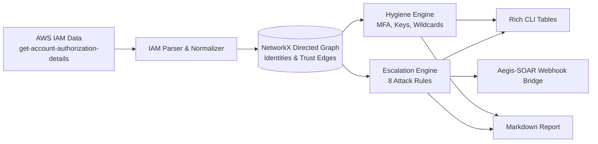

# CloudPath: Graph-Based AWS IAM Attack-Path & Privilege Escalation Auditor 🌐🛡️

**Identify privilege escalation chains, multi-hop role-assumption graphs, and identity hygiene flaws in AWS environments.**  
*Engineered by [Vasilis Tsiamouras](https://www.linkedin.com/in/vasilis-tsiamouras/)*

[](https://www.python.org/)
[](https://networkx.org/)
[](https://pydantic.dev/)
[](https://opensource.org/licenses/MIT)

---

## 📌 Overview

AWS Identity and Access Management (IAM) permissions can easily compound into unintended privilege escalation paths. An unprivileged user or role with seemingly benign permissions (`iam:CreateAccessKey`, `iam:PassRole` with `ec2:RunInstances`, or `iam:UpdateAssumeRolePolicy`) can frequently escalate to full Administrator access.

**CloudPath** is an offline, graph-based security analysis tool that maps AWS IAM configurations into directed graphs using **NetworkX**, tracing all deterministic escalation paths and hygiene issues without needing active AWS credentials during evaluation.

---

## 🏗️ Architecture



### Key Capabilities
1. **Multi-Hop Graph Traversal:** Identifies multi-step `AssumeRole` chains where Identity A assumes Role B, which assumes administrative Role C.
2. **8 Privilege Escalation Rules:**
   - `iam:PassRole` combined with `ec2:RunInstances` or `lambda:CreateFunction`
   - `iam:CreateAccessKey` on target administrative identities
   - `iam:AttachUserPolicy` / `iam:AttachGroupPolicy`
   - Multi-hop `sts:AssumeRole` chain traversal
   - Wildcard principal trust policies (`Principal: *`)
   - `iam:CreateLoginProfile` / `iam:UpdateLoginProfile`
   - `iam:UpdateAssumeRolePolicy` trust document tampering
   - `iam:SetDefaultPolicyVersion` rollbacks
3. **Identity Hygiene Auditing:**
   - Console access without Multi-Factor Authentication (MFA)
   - Stale access keys active for $> 90$ days
   - Overly permissive wildcard statements (`Action: *`, `Resource: *`)
   - Unrestricted cross-account trust relationships
4. **SOAR Integration:** Automatically dispatches alerts for critical escalation paths directly to **Aegis-SOAR**.

---

## 📁 Repository Structure

```
cloudpath/
├── README.md                          # Documentation
├── requirements.txt                   # Dependencies (networkx, rich, pydantic, requests)
├── run_cloudpath.py                   # CLI runner and benchmark auditor
├── cloudpath/
│   ├── parser.py                      # IAM authorization details parser & normalizer
│   ├── graph.py                       # NetworkX IAM directed graph model
│   ├── analyzer.py                    # Attack-path orchestrator
│   ├── reporter.py                    # Terminal renderer & Markdown export
│   ├── soar_bridge.py                 # Forwarder to Aegis-SOAR incident response
│   └── rules/
│       ├── escalation.py              # Privilege escalation detection rules
│       └── hygiene.py                 # Security hygiene checks
├── fixtures/
│   └── cloudgoat_iam_privesc.json     # CloudGoat IAM privilege escalation benchmark
├── tests/
│   └── test_rules.py                  # Unit and integration test suite
└── reports/                           # Output directory for audit reports
```

---

## 🚀 Quickstart Guide

### 1. Installation

```bash
git clone https://github.com/Unskilled0ne/cloudpath.git
cd cloudpath

python3 -m venv venv
source venv/bin/activate
pip install -r requirements.txt
```

### 2. Run Audit Against Benchmark Fixture

Run an analysis against the included CloudGoat privilege escalation environment:

```bash
./run_cloudpath.py --fixture fixtures/cloudgoat_iam_privesc.json
```

This will:
1. Parse users, roles, groups, managed policies, and inline statements.
2. Build the privilege and trust graph.
3. Detect escalation paths to administrator roles.
4. Render findings in styled terminal tables and save `reports/attack_paths.md`.

### 3. Audit a Live AWS Account

Export account IAM details using the AWS CLI and run CloudPath offline:

```bash
# 1. Export IAM authorization details
aws iam get-account-authorization-details > account_iam.json

# 2. Run CloudPath auditor
./run_cloudpath.py --fixture account_iam.json --report reports/live_audit.md
```

### 4. Run Unit Tests

```bash
./venv/bin/python -m unittest discover -s tests
```

---

## 👤 Author

**Vasilis Tsiamouras**  
- LinkedIn: [linkedin.com/in/vasilis-tsiamouras](https://www.linkedin.com/in/vasilis-tsiamouras/)  
- Focus: Cloud Security, Offensive Security & Penetration Testing | University of Thessaly
